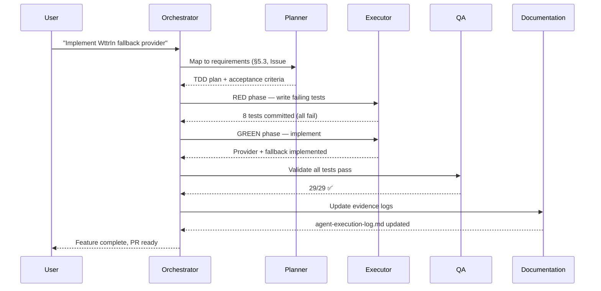

# Agent Orchestration Workflow

This document describes how the **Orchestrator Agent** coordinates specialized agents to deliver features end-to-end. It includes a real, worked example from this project.

---

## Orchestrator Agent Role

The Orchestrator Agent (`.github/agents/orchestrator.agent.md`) is responsible for:

1. **Understanding** the user's request and mapping it to requirements
2. **Decomposing** work into phases (planning, testing, implementation, docs)
3. **Delegating** to specialized agents (Executor, QA, Documentation)
4. **Enforcing** TDD as the default workflow
5. **Verifying** completion against acceptance criteria

---

## Agent Interaction Model

---

## Real Example: WttrIn Fallback Provider (Issue #7)

### Phase 1: Requirement Mapping (Orchestrator)

The Orchestrator received the request and:
- Identified requirement §5.3: "Use one or two open weather providers"
- Found Issue #7 from Planner Agent's epic decomposition
- Determined acceptance criteria from the issue
- Chose implementation sequence: tests → provider → fallback → wiring

### Phase 2: TDD Test Design (Orchestrator → Executor)

The Orchestrator delegated to Executor with these constraints:
- **Skill applied**: `tdd-implementation` (tests MUST be written first)
- **Instruction applied**: `testing.instructions.md` (pytest patterns, mocking)

Executor produced 8 tests in 2 files:
- `test_wttr_in_provider.py` — 4 tests for provider behavior
- `test_fallback_service.py` — 4 tests for fallback logic

**RED commit**: `19122b0` — all 8 tests fail

### Phase 3: Implementation (Orchestrator → Executor)

The Orchestrator delegated implementation with constraints:
- **Skill applied**: `code-review-standards` (provider ABC, type hints, error handling)
- **Instruction applied**: `backend.instructions.md` (layered architecture)

Executor produced:
- `backend/providers/wttr_in.py` — WttrIn provider
- `backend/services/weather_service.py` — fallback logic
- `backend/main.py` — wiring both providers

### Phase 4: Validation (Orchestrator → QA)

QA Agent verified:
- All 29 tests pass (21 existing + 8 new)
- No regressions introduced
- Code follows established patterns

### Phase 5: Documentation (Orchestrator → Documentation)

Documentation Agent updated:
- `docs/agent-execution-log.md` with structured evidence entry
- Skills influence recorded for traceability

---

## Orchestrator Decision Rules

| Situation | Orchestrator Decision |
|-----------|---------------------|
| New feature request | Map to requirements → delegate to Planner if ambiguous |
| Implementation task | Enforce TDD → delegate RED to Executor → then GREEN |
| Code ready for review | Delegate to QA Agent with code-review-standards skill |
| PR ready | Ensure Documentation Agent updated evidence logs |
| Scope creep detected | Reference requirements-analysis skill, reject out-of-scope |
| Tests fail after implementation | Send back to Executor with failure context |

---

## Skills That Shape Orchestration

| Skill | How It Influences Orchestrator |
|-------|-------------------------------|
| `tdd-implementation` | Forces RED→GREEN→REFACTOR phase ordering |
| `requirements-analysis` | Ensures work maps to documented requirements |
| `code-review-standards` | Defines quality gates before considering work "done" |
| `documentation-writer` | Requires evidence updates alongside implementation |

---

## Quality Gates (Orchestrator Checklist)

Before the Orchestrator considers a task complete:

- [ ] Requirement traceability — linked to specific §section
- [ ] TDD evidence — RED commit exists before GREEN commit
- [ ] Tests pass — full suite green
- [ ] Code standards — follows backend/frontend/testing instructions
- [ ] Documentation — execution log updated
- [ ] Demo-readiness — evidence is clear for reviewers

---

## How This Demonstrates §4.1

The requirements state the Orchestrator Agent should:

| Requirement | Evidence |
|-------------|----------|
| "Understand the user's request" | Maps requests to §sections and Issues |
| "Decompose work into smaller tasks" | Breaks into RED/GREEN/REFACTOR/DOCS phases |
| "Delegate work to appropriate agents" | Routes to Executor, QA, Documentation |
| "Collect agent outputs" | Gathers test results, code, log entries |
| "Verify completion" | Runs quality gate checklist |
| "Coordinate overall workflow" | Enforces phase ordering, blocks bad sequences |
