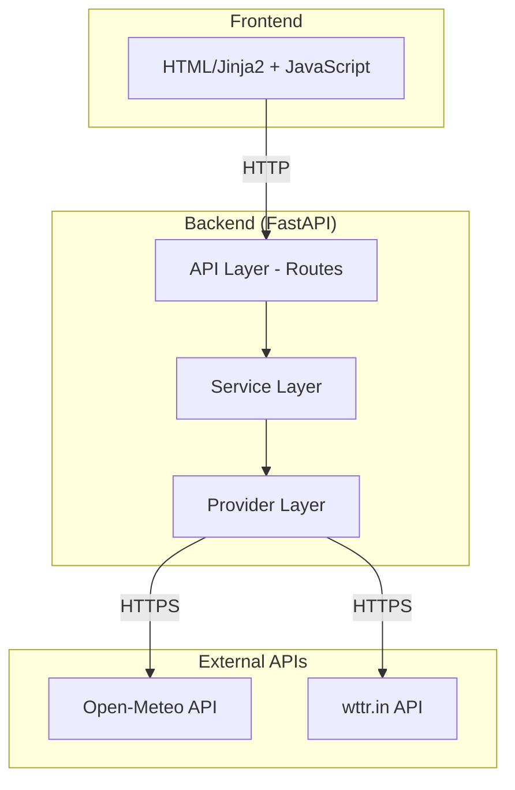
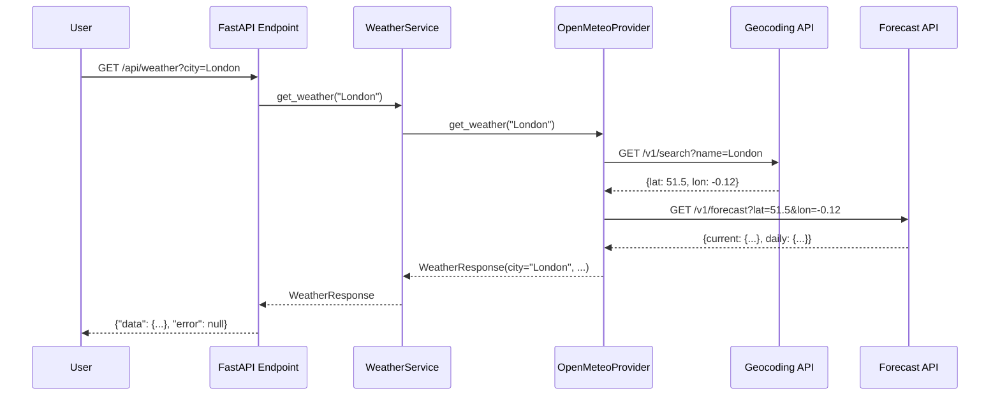
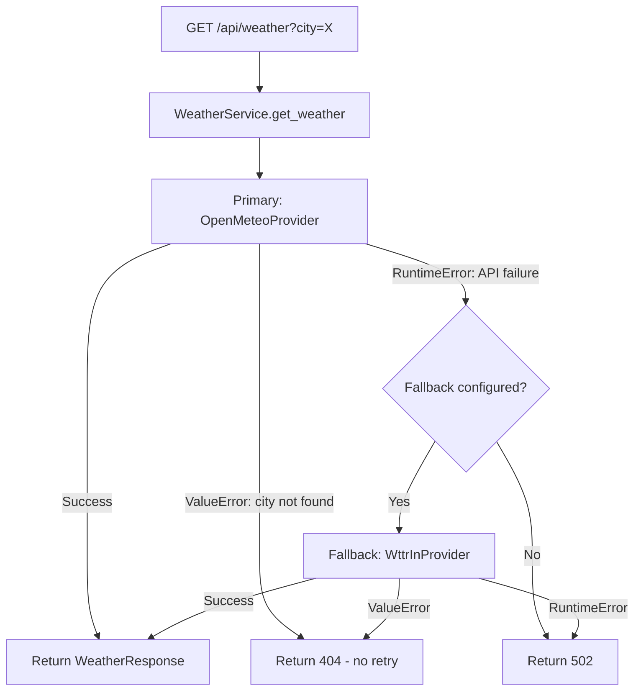

# Architecture Overview

This document explains the system design of the Weather Forecast Demo application.

## High-Level Architecture



## Design Principles

1. **Layered architecture** — Routes → Services → Providers (separation of concerns)
2. **Dependency inversion** — Providers implement an abstract interface (`WeatherProvider`)
3. **Single responsibility** — Each module has one clear job
4. **Testability** — External APIs mocked at the provider boundary
5. **Configuration via environment** — No hardcoded values

---

## Layer Details

### API Layer (`backend/main.py`)

- Thin route handlers — no business logic
- Input validation via FastAPI/Pydantic
- Consistent response envelope: `{"data": ..., "error": null}`
- Error mapping: `ValueError` → 404, `RuntimeError` → 502

### Service Layer (`backend/services/weather_service.py`)

- Business logic and orchestration
- Provider-agnostic — works with any `WeatherProvider` implementation
- **Fallback logic**: If primary provider raises `RuntimeError`, tries fallback provider
- `ValueError` (city not found) is NOT retried — result is definitive
- Structured logging via structlog when fallback is triggered

### Provider Layer (`backend/providers/`)

- `base.py` — `WeatherProvider` ABC defining the contract
- `open_meteo.py` — Primary provider (Open-Meteo + geocoding)
- `wttr_in.py` — Secondary/fallback provider (wttr.in JSON API)

### Models (`backend/models/weather.py`)

- `WeatherResponse` — Canonical Pydantic model normalizing provider responses
- Shared across all layers as the common data contract

### Configuration (`backend/config.py`)

- `Settings` class using Pydantic `BaseSettings`
- All values from environment variables (prefix: `WEATHER_`)
- Sensible defaults for local development

---

## Data Flow



---

## Fallback Flow



---

## Error Handling Strategy

| Error Source | HTTP Status | Response |
|-------------|-------------|----------|
| City not found (geocoding returns empty) | 404 | `{"data": null, "error": "City not found: X"}` |
| Provider API failure | 502 | `{"data": null, "error": "Weather service unavailable: ..."}` |
| Missing query parameter | 422 | FastAPI validation error |
| Successful response | 200 | `{"data": {weather object}, "error": null}` |

---

## Technology Choices

| Choice | Rationale |
|--------|-----------|
| **FastAPI** | Async-native, auto-OpenAPI docs, Pydantic integration |
| **httpx** | Async HTTP client with timeout support |
| **Pydantic v2** | Fast validation, `BaseSettings` for config |
| **structlog** | Structured JSON logging for production |
| **Open-Meteo** | Free, no API key, reliable, good documentation |
| **pytest + pytest-asyncio** | Industry standard, excellent async support |

---

## Directory Structure

```
backend/
├── __init__.py
├── main.py              # FastAPI app + route definitions
├── config.py            # Settings from environment
├── models/
│   ├── __init__.py
│   └── weather.py       # WeatherResponse Pydantic model
├── services/
│   ├── __init__.py
│   └── weather_service.py  # Business logic
├── providers/
│   ├── __init__.py
│   ├── base.py          # WeatherProvider ABC
│   └── open_meteo.py    # Open-Meteo implementation
└── templates/           # Jinja2 templates (future)
```

---

## Future Extensions

- **WttrIn fallback provider** — automatic failover when Open-Meteo is unavailable
- **Frontend** — Jinja2 templates with city search and weather display
- **Response caching** — reduce external API calls (out of scope per requirements)
