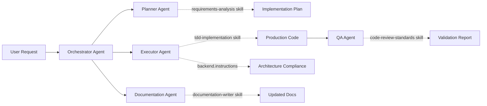

# Copilot Usage Guide

This document explains how GitHub Copilot AI technologies are used throughout the development lifecycle of this project.

## Overview

This project uses GitHub Copilot in **Agent Mode** with a structured system of:
- **Agents** — specialized AI roles with defined responsibilities
- **Skills** — behavioral constraints that shape how agents work
- **Instructions** — path-scoped coding standards agents must follow
- **MCP Servers** — external tool integrations (GitHub API)

---

## Components

### Agents (`.github/agents/`)

| Agent | Role | Primary Skills |
|-------|------|---------------|
| **Orchestrator** | Coordinates all work across agents | requirements-analysis, tdd-implementation |
| **Planner** | Breaks requirements into tasks with acceptance criteria | requirements-analysis |
| **Executor** | Implements features using strict TDD | tdd-implementation, code-review-standards |
| **QA** | Validates features against acceptance criteria | code-review-standards, tdd-implementation |
| **Code Review** | Reviews code for quality and standards | code-review-standards |
| **Documentation** | Generates and maintains project docs | documentation-writer |

### Skills (`.github/skills/`)

Skills don't implement logic — they **shape behavior**. See [Skills Overview](skills-overview.md) for details.

| Skill | What It Enforces |
|-------|-----------------|
| `tdd-implementation` | RED→GREEN→REFACTOR cycle, commit discipline |
| `code-review-standards` | Python best practices, API consistency, error handling |
| `requirements-analysis` | Scope alignment, testable acceptance criteria |
| `documentation-writer` | Diátaxis framework, evidence recording |

### Instructions (`.github/instructions/`)

Path-scoped instructions apply automatically when working on matching files:

| Instruction | Applies To | Key Standards |
|-------------|-----------|---------------|
| `backend.instructions.md` | `backend/**` | Layered architecture, FastAPI patterns, httpx, Pydantic v2 |
| `frontend.instructions.md` | `frontend/**` | Jinja2 templates, vanilla JS, accessibility |
| `testing.instructions.md` | `tests/**`, `**/test_*.py` | pytest, async fixtures, mocking, naming conventions |

### Global Instructions (`copilot-instructions.md`)

Applies to all work:
- TDD is mandatory
- Evidence must be recorded
- Work must be traceable to requirements
- Documentation must stay current

---

## Workflow: How It All Connects

### Typical Development Cycle

1. **User** describes a feature or requirement
2. **Orchestrator** maps it to `REQUIREMENTS_SUMMARY.md` and plans phases
3. **Planner** (if needed) breaks work into tasks with acceptance criteria
4. **Executor** implements using TDD:
   - Writes failing tests (RED)
   - Implements minimal code (GREEN)
   - Refactors (REFACTOR)
5. **QA** validates tests pass and standards are met
6. **Documentation** updates relevant docs and evidence logs
7. **Code Review** checks quality before merge

---

## GitHub App Integration

The project uses the official [GitHub App](https://github.com/github/app) for:

- **Repository context** — agents understand project structure and history
- **Issue awareness** — work tracked through GitHub Issues
- **Pull request context** — PRs created with TDD evidence and change summaries
- **Code navigation** — agents search and understand the codebase

---

## MCP Server Usage

### GitHub MCP Server

Used for repository operations:
- Creating pull requests with structured descriptions
- Searching code across the repository
- Reading file contents for context
- Referencing the previous project (`epam-mbg-demo/copilot-agents-newsfeed-demo`)

See [MCP Integration Summary](mcp-integration-summary.md) for detailed examples.

---

## Evidence Trail

Every AI-assisted action produces traceable evidence:

| Evidence Type | Location |
|--------------|----------|
| TDD commit messages | Git history (`test:`, `feat:`, `refactor:` prefixes) |
| Agent execution log | `docs/agent-execution-log.md` |
| TDD workflow proof | `docs/tdd-workflow-evidence.md` |
| Architecture decisions | `docs/architecture-overview.md` |
| PR descriptions | GitHub PR history |

---

## Reusability

All agents, skills, and instructions are designed to be **reusable across projects**:

- Agents define roles, not project-specific logic
- Skills define behavioral patterns, not implementation details
- Instructions define standards that apply to any Python/FastAPI project
- The `copilot-agents-newsfeed-demo` project uses a similar structure, proving portability
