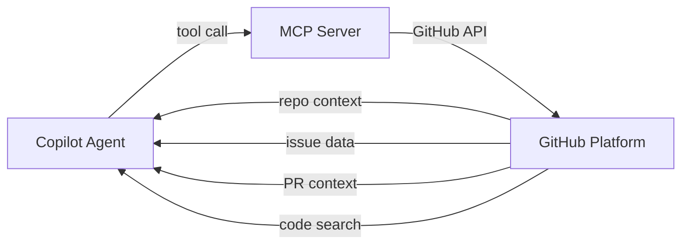

# MCP Integration Summary

This document describes how Model Context Protocol (MCP) servers extend GitHub Copilot's capabilities in this project.

---

## What is MCP?

The Model Context Protocol allows GitHub Copilot to interact with external tools and services beyond its built-in capabilities. MCP servers provide additional context and actions that agents can use during development.

---

## MCP Servers Used

### GitHub MCP Server

**Purpose**: Repository-aware development operations

**Capabilities used:**

| Capability | How It Was Used |
|-----------|----------------|
| `get_file_contents` | Read agent/skill definitions from `epam-mbg-demo/copilot-agents-newsfeed-demo` for reuse |
| `search_code` | Search across repositories for patterns and implementations |
| Pull request creation | Created PRs with structured descriptions and TDD evidence |
| Issue management | Future: tracking implementation tasks |

**Example interactions:**

1. **Cross-repository reference** — Read `.github/agents/` and `.github/skills/` from the previous newsfeed-demo project to verify reuse patterns
2. **PR creation** — Generated pull requests with architecture diagrams, TDD evidence tables, and verification steps

---

## Configuration

MCP servers are configured in the development environment (VS Code / Copilot CLI). No project-level MCP configuration files are required for the GitHub MCP server as it's built into the GitHub Copilot platform.

### Future MCP Integrations

| Server | Potential Use |
|--------|--------------|
| **Filesystem MCP** | Direct file operations during automated workflows |
| **Playwright MCP** | Frontend testing and visual verification |
| **Documentation MCP** | Searching external documentation for API references |

---

## How MCP Enhances the Workflow



### Without MCP
- Agents only see local file context
- No ability to create issues/PRs programmatically
- No cross-repository awareness

### With MCP
- Agents can reference other repositories for reuse patterns
- PRs created directly with rich descriptions
- Code search across the entire organization
- Issue tracking integrated into the development workflow

---

## Evidence of MCP Usage

| Date | Operation | MCP Tool | Result |
|------|-----------|----------|--------|
| 2026-07-26 | Read newsfeed-demo agents | `get_file_contents` | Confirmed 6 agents available for reuse |
| 2026-07-26 | Read newsfeed-demo skills | `get_file_contents` | Confirmed 6 skills in reference project |
| 2026-07-26 | Create Phase 1 PR | `create_pull_request` | PR #2 created with scaffolding summary |
| 2026-07-26 | Create Phase 2 PR | `create_pull_request` | PR #3 created with TDD evidence |
| 2026-07-26 | Create documentation PR | `create_pull_request` | PR #4 with AI usage evidence |
| 2026-07-26 | Create planner evidence PR | `create_pull_request` | PR #10 with epic decomposition |
| 2026-07-26 | Create 5 GitHub Issues | `create_issue` | Issues #5–#9 (epics with TDD specs) |
| 2026-07-26 | Create frontend PR | `create_pull_request` | PR #11 with orchestrator coordination |
| 2026-07-26 | Create WttrIn PR | `create_pull_request` | PR #12 with fallback provider |
| 2026-07-26 | Create E2E/orchestration PR | `create_pull_request` | PR #13 with integration tests |
| 2026-07-26 | Search code in newsfeed-demo | `search_code` | Found reusable agent patterns |

---

## MCP Interaction Examples

### Example 1: Cross-Repository Reference

```
Tool: get_file_contents
Owner: epam-mbg-demo
Repo: copilot-agents-newsfeed-demo
Path: .github/agents

Result: Discovered 7 agents (orchestrator, planner, executor, qa,
code-review, research, security-review) — reused 6 in this project.
```

### Example 2: Issue Creation with TDD Specs

```
Tool: create_issue
Title: [Epic] WttrIn Fallback Provider
Body: (structured with Tests to Write FIRST, Acceptance Criteria)

Result: Issue #7 created with full TDD plan,
enabling traceable requirement-to-implementation flow.
```

### Example 3: Pull Request with Evidence

```
Tool: create_pull_request
Title: Feature: WttrIn fallback provider with service failover (Issue #7)
Body: (includes TDD evidence table, architecture diagram, skills used)

Result: PR #12 with Mermaid diagram, commit SHAs for RED/GREEN phases,
and explicit skill/instruction attribution.
```

### Example 4: Code Search for Patterns

```
Tool: search_code
Query: "WeatherProvider" language:python repo:epam-mbg-demo/copilot-agents-weather-demo

Result: Located all provider implementations and their usage
across the codebase for consistency verification.
```

---

## GitHub App Integration

The project uses the [GitHub App](https://github.com/github/app) for repository-aware development:

| Capability | How Used |
|-----------|----------|
| Repository context | Agents understand project structure and file organization |
| Issue awareness | Epics tracked as GitHub Issues, linked in PRs |
| Pull request context | PRs created with TDD evidence, architecture diagrams |
| Code navigation | Agents search and understand codebase for consistency |
| Cross-repo reference | Read patterns from previous newsfeed-demo project |
