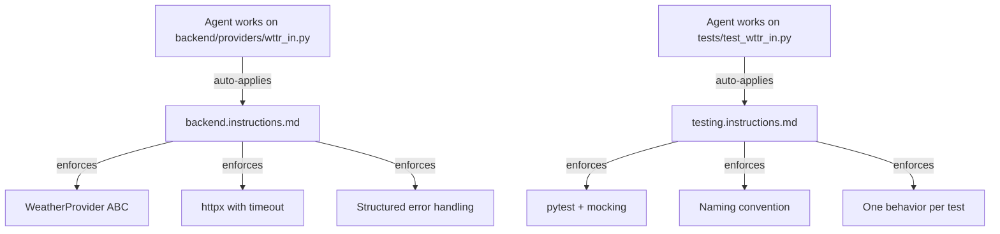

# Repository Instructions Guide

This document explains how **Repository Instructions** (`.github/instructions/`) define engineering standards that all GitHub Copilot agents must follow when working on specific parts of the codebase.

---

## What Are Repository Instructions?

Repository Instructions are path-scoped Markdown files that automatically apply to Copilot agents when they work on matching file patterns. They define coding standards, architecture patterns, and quality expectations without requiring manual enforcement.

---

## Instructions in This Project

### Global Instructions (`.github/copilot-instructions.md`)

**Applies to**: All files, all agents

**Key standards enforced**:
- TDD is mandatory for every feature
- Work must be traceable to documented requirements
- Evidence must be recorded for the Copilot demonstration
- Prefer clarity and reproducibility over cleverness
- Small, reviewable steps with explicit acceptance criteria

---

### Backend Instructions (`.github/instructions/backend.instructions.md`)

**Applies to**: `backend/**`

**Architecture standards**:
- Layered architecture: routes → services → providers
- Weather providers isolated behind `WeatherProvider` ABC
- Thin route handlers — logic delegated to service layer
- Dependency injection via FastAPI's `Depends()`

**Technology standards**:
- FastAPI (Python 3.11+)
- httpx with async and timeouts
- Pydantic v2 for validation
- structlog for JSON logging
- pytest + pytest-asyncio for testing

**API design standards**:
- `GET /api/weather?city={city}` — consistent response envelope
- `GET /api/health` — health check
- Proper HTTP status codes (200, 404, 422, 502)
- Auto-generated OpenAPI docs

**Evidence of enforcement**:
- `backend/providers/base.py` → WeatherProvider ABC exists
- `backend/providers/open_meteo.py` → implements the ABC
- `backend/providers/wttr_in.py` → second implementation
- `backend/services/weather_service.py` → service layer with fallback
- `backend/main.py` → thin route handlers, structured error responses
- `backend/config.py` → Pydantic BaseSettings, environment variables

---

### Frontend Instructions (`.github/instructions/frontend.instructions.md`)

**Applies to**: `frontend/**`

**UX standards**:
- Single-page with one search interaction
- City search input with submit button
- Display: temperature, description, humidity, wind speed, forecast
- Loading, error, and empty states

**Implementation standards**:
- Jinja2 templates served by FastAPI
- Vanilla JavaScript (fetch API)
- No build tools (no webpack, no npm)
- Minimal CSS, basic accessibility

**Evidence of enforcement**:
- `frontend/index.html` → single HTML file with inline CSS + JS
- Uses `fetch()` API for weather requests
- Has `<label>` elements and `aria-label` for accessibility
- Loading spinner, error display, empty state all implemented

---

### Testing Instructions (`.github/instructions/testing.instructions.md`)

**Applies to**: `tests/**`, `**/test_*.py`, `**/*_test.py`

**Framework standards**:
- pytest as primary framework
- pytest-asyncio for async tests
- httpx.AsyncClient for API testing
- respx or unittest.mock for mocking

**Test design standards**:
- File naming: `test_<module>.py`
- Function naming: `test_<behavior>_<scenario>`
- Each test tests ONE behavior
- Tests are independent and deterministic
- External services always mocked
- Both success and failure scenarios

**Evidence of enforcement**:
- All 34 tests follow `test_<behavior>_<scenario>` naming
- External APIs mocked in every provider test
- No network calls in any test
- Separate files per concern (models, providers, service, endpoints, integration)

---

## How Instructions Shape Agent Behavior

Instructions are **not optional suggestions** — they are constraints that agents follow automatically. This ensures consistency even when different agents (Executor, QA, Code Review) work on the same files at different times.

---

## Reusability

These instructions can be reused in any Python/FastAPI project by:
1. Copying the `.github/instructions/` directory
2. Adjusting path patterns in the `applyTo` frontmatter
3. Updating technology references if the stack changes

The patterns themselves (layered architecture, TDD, structured error handling) are universal.
