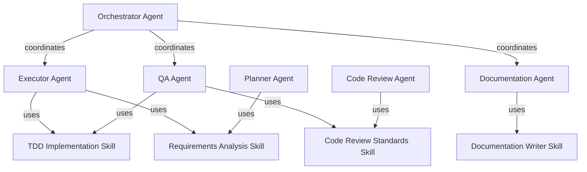

# Skills Overview

This document explains how **Copilot Skills** shape agent behavior in this project. Skills are behavioral constraints and workflows that ensure agents adhere to engineering standards consistently.

## What Are Skills?

Skills (inspired by [agentskills.io](https://agentskills.io)) are reusable behavioral definitions that influence how GitHub Copilot agents approach tasks. They don't implement application logic — they **shape how agents work**.

## Skills in This Project

| Skill | Pattern | Purpose |
|-------|---------|---------|
| `tdd-implementation` | Behavioral constraint | Enforces RED→GREEN→REFACTOR cycle |
| `code-review-standards` | Verification checklist | Ensures Python best practices and API consistency |
| `requirements-analysis` | Analytical workflow | Maps work to requirements, identifies gaps |
| `documentation-writer` | Content generation | Maintains docs following Diátaxis framework |

---

## Skill Details

### 1. TDD Implementation

**Location:** `.github/skills/tdd-implementation/SKILL.md`
**Category:** `engineering-standards`
**Pattern:** `behavioral-constraint`

**How it shapes behavior:**
- Forces agents to write tests BEFORE any production code
- Requires confirmation that tests fail before implementation begins
- Limits implementation to minimal code that satisfies tests
- Enforces commit discipline with phase-labeled messages (`test:`, `feat:`, `refactor:`)

**Evidence of usage:**
- Phase 2 (Weather Service): Tests committed first (`149a5dd`), then implementation (`3d33eda`)
- All 16 tests were written before their corresponding modules existed

---

### 2. Code Review Standards

**Location:** `.github/skills/code-review-standards/SKILL.md`
**Category:** `quality-assurance`
**Pattern:** `verification-checklist`

**How it shapes behavior:**
- Defines severity levels (Blocking / Non-blocking / Suggestion)
- Enforces PEP 8, type hints, docstrings (Google style)
- Requires external APIs behind service layer abstractions
- Mandates structured error responses and proper HTTP status codes
- Checks TDD compliance during code review

**Evidence of usage:**
- All code follows layered architecture (routes → services → providers)
- Type hints on all public functions
- Structured response envelope `{"data": ..., "error": null}`
- External APIs isolated behind `WeatherProvider` ABC

---

### 3. Requirements Analysis

**Location:** `.github/skills/requirements-analysis/SKILL.md`
**Category:** `planning`
**Pattern:** `analytical-workflow`

**How it shapes behavior:**
- Requires reading `REQUIREMENTS_SUMMARY.md` before proposing work
- Distinguishes primary deliverable (AI demo evidence) from secondary (weather app)
- Produces testable acceptance criteria
- Ensures tasks include TDD test specifications
- Separates in-scope from out-of-scope work

**Evidence of usage:**
- Phase 1 and 2 were planned against documented requirements
- Scope boundaries respected (no auth, no DB, no caching)
- Each phase mapped to specific requirement sections

---

### 4. Documentation Writer

**Location:** `.github/skills/documentation-writer/SKILL.md`
**Category:** `documentation`
**Pattern:** `content-generation`

**How it shapes behavior:**
- Follows Diátaxis framework (Tutorials, How-to, Reference, Explanation)
- Maintains required document list (README, setup guide, architecture, etc.)
- Records Copilot AI workflow evidence with structured log entries
- Uses consistent terminology and cross-references

**Evidence of usage:**
- `README.md` follows How-to pattern
- `docs/setup-guide.md` follows Tutorial pattern
- This document follows Explanation pattern

---

## How Agents Consume Skills

Each agent references skills implicitly through the behavioral rules they define. Skills are not "called" — they **constrain and shape** how agents approach their work.

---

## Design Principles

1. **Skills are reusable** — they can be ported to any Python project with minimal changes
2. **Skills enforce standards** — they don't do work, they define how work should be done
3. **Skills are composable** — multiple agents can use the same skill
4. **Skills are traceable** — their influence is visible in commit messages and code structure
